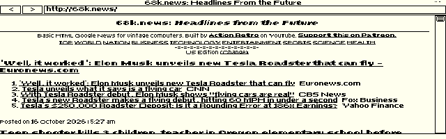

# ELKSWeb

An experimental graphical web browser for [ELKS Linux](https://github.com/ghaerr/elks), written in C with the native ELKS IA16 toolchain and targeting 8088-compatible machines.

Inspired by [the ELKS graphical-browser discussion (#2185)](https://github.com/ghaerr/elks/discussions/2185) and [MicroWeb](https://github.com/jhhoward/MicroWeb). ELKSWeb is an original implementation; MicroWeb is the visual and behavioral comparison reference.

**Developer preview — not ready for public beta.** Real 8088 emulation can load live pages, but performance and navigation defects remain. See [known issues and test evidence](docs/STATUS.md).



Actual 640×200 CGA framebuffer capture from Windows 86Box, 16 October 2026. Intel 8088 at 4.77 MHz, 640 KB RAM. The first visible 68k.news page took approximately eight minutes; this screenshot is evidence of rendering, not acceptable speed. [Scrolled view](docs/screenshots/68k-page-down.png) · [Footer](docs/screenshots/68k-footer.png)

## Design

The discussion's C++, networking, graphics-dependency and memory concerns guide the implementation:

- **C and the native ELKS toolchain:** IA16 GCC and ELKS libc; no C++ runtime or OpenWatcom requirement.
- **ELKS networking:** native sockets and the ELKS `ktcp` service; no DOS packet driver or mTCP dependency. Direct access is HTTP only.
- **Direct graphics:** the browser draws to the CGA framebuffer and uses ELKS console interfaces. Microwindows/Nano-X is not required.
- **Bounded memory:** segmented storage, explicit document limits and a small disk-backed source cache. These choices reduce conventional-memory pressure but currently incur substantial CPU and disk costs.

## Tested configuration and requirements

- An ELKS system with graphics-capable console interfaces and a working native network stack.
- 8088-compatible processor target; exercised in 86Box with an Intel 8088 at 4.77 MHz and 640 KB RAM. Physical hardware remains unvalidated.
- CGA-compatible 640×200 monochrome graphics.
- A writable `/tmp` for page caching.
- Keyboard navigation; PS/2 mouse support exists but was not tested in the 8088 run.

640 KB is the tested configuration, not a proven minimum. General ELKS compatibility is the priority; HP 200LX/Hornet-specific validation is future work.

## Current features

HTTP and local HTML/text files, relative links, redirects, anchors, scrolling, forms, tables, lists, monochrome GIF images and binary downloads. PNG/JPEG dimensions are recognized for layout, but their pixels are not decoded. Features have differing levels of test coverage; see [tests](tests/README.md).

## Limitations

- Slow 8088 page processing and redraws; input can wait minutes during parsing.
- Back navigation from an HTTP page to a previous local file is broken.
- HTTP only; no native TLS, CSS or JavaScript. `HTTP_PROXY` is supported, but HTTPS conversion requires an external service and is not provided here.
- One display mode: 640×200 monochrome CGA. No startup resolution selector yet.
- Large or complex pages can exceed fixed layout limits. HTML source is capped at 120 KB; layout at 24 KB of text, 1,024 runs and 256 links.
- Some accented characters are transliterated rather than rendered faithfully.
- No claim of complete MicroWeb parity, physical 8088 certification or public-beta readiness.

## Keyboard shortcuts

| Key | Action |
| --- | --- |
| F6 / Ctrl-L | Edit address |
| Tab / Shift-Tab | Select link or control |
| Enter | Activate selection |
| Arrows / Page Up / Page Down | Scroll |
| Home / End | Start / end of document |
| Backspace | Back (local-file history bug remains) |
| F5 | Reload |
| F2 | Invert monochrome output |
| F3 | Show/hide browser bars |
| Escape | Exit; cancel a network load when input is polled |

## Command-line options

```text
elksweb [-invert] [-noimages] [http://URL or local-file]
```

`-noimages` disables image loading. It does not establish a performance target. Display mode is currently fixed; MicroWeb's `-video`, EMS and XMS options are not implemented.

## Getting started and building

This initial repository contains source, tests and screenshots. No ready-to-use release image is published yet.

See [BUILDING.md](docs/BUILDING.md) for native compilation, optional image packaging and QEMU testing. Emulator boot success must be evaluated separately from slow 8088 behavior.

## Test sites and related projects

- [68k.news](http://68k.news/) — used in the actual live screenshots; [ActionRetro/68k-news source](https://github.com/ActionRetro/68k-news).
- [FrogFind](http://frogfind.com/) — included in live QA attempts; the latest Windows run did not render it. [Source](https://github.com/ActionRetro/FrogFind).
- [MicroWeb](https://github.com/jhhoward/MicroWeb) — inspiration and independent comparison reference.
- [ELKS](https://github.com/ghaerr/elks) — operating system, toolchain and networking.

These projects are credited for their respective work; no endorsement or affiliation is implied.

## Contributing

See [CONTRIBUTING.md](CONTRIBUTING.md). Current priorities are profiling the 8088 path, reducing repeated parsing and URL comparisons, fixing local-file history, and improving progress/cancellation before broader testing.

## License and attribution

Original browser code is GPL-2.0-or-later; see [COPYING](COPYING). Independently sourced font data retains its [X.Org/Adobe/DEC notices](font/COPYING) and [provenance](font/provenance.json). No MicroWeb source, font, image assets or executable is embedded in ELKSWeb. Website content visible in screenshots belongs to its respective providers.
