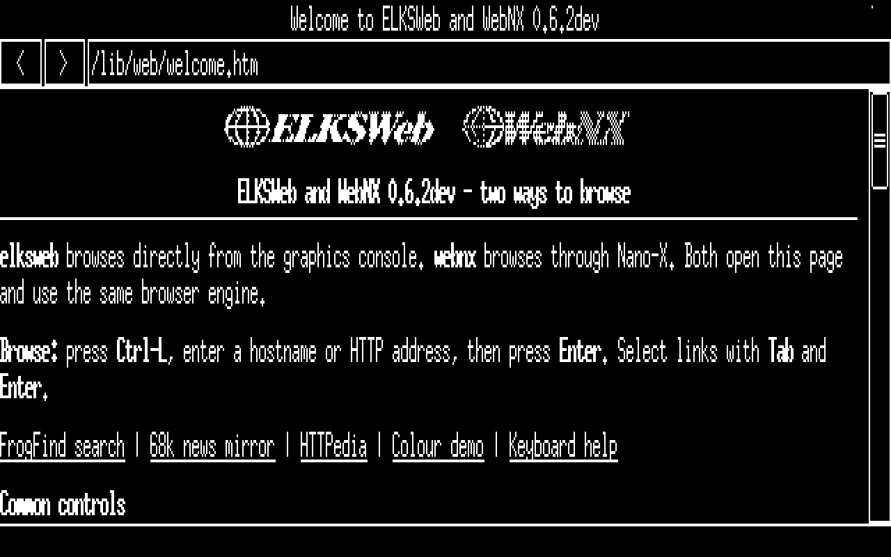
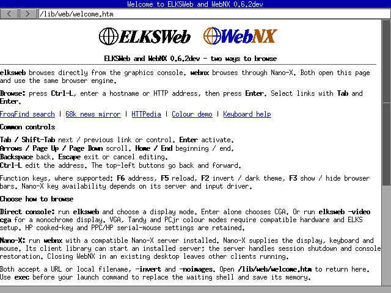
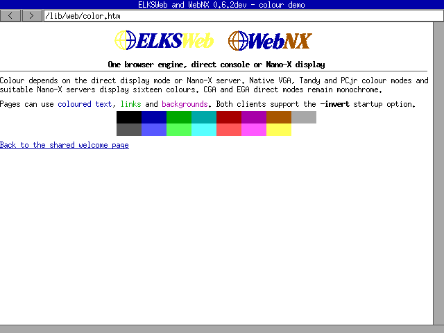
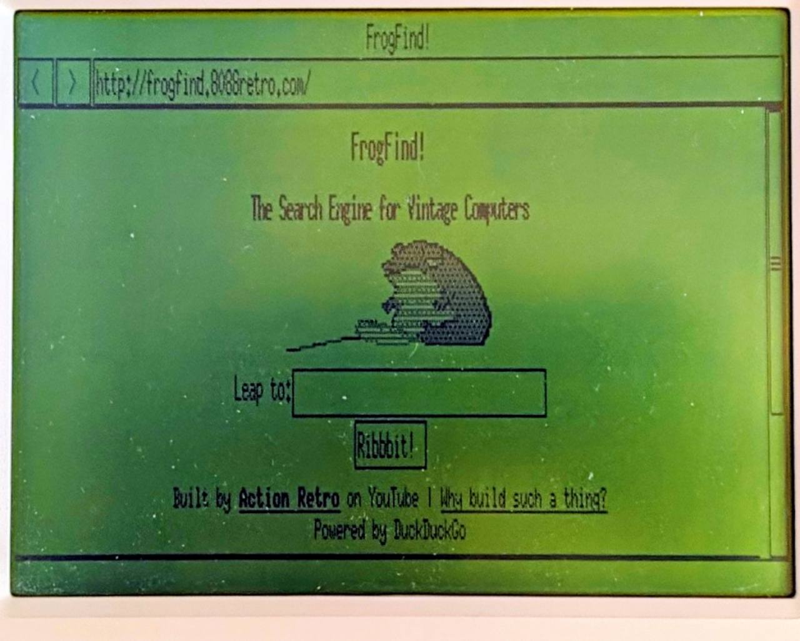
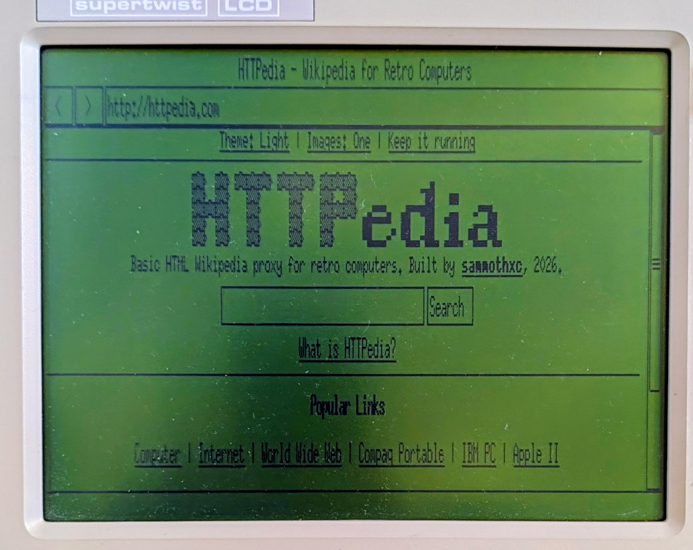
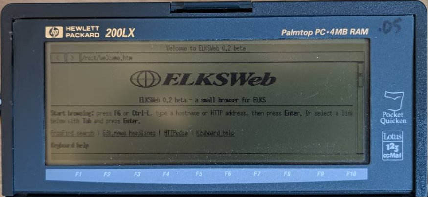
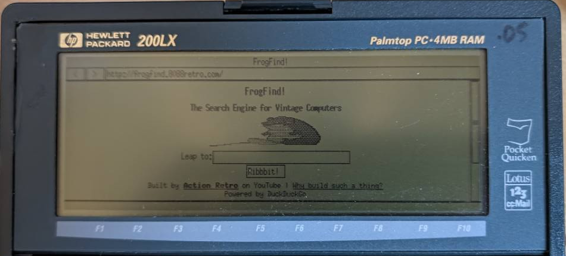
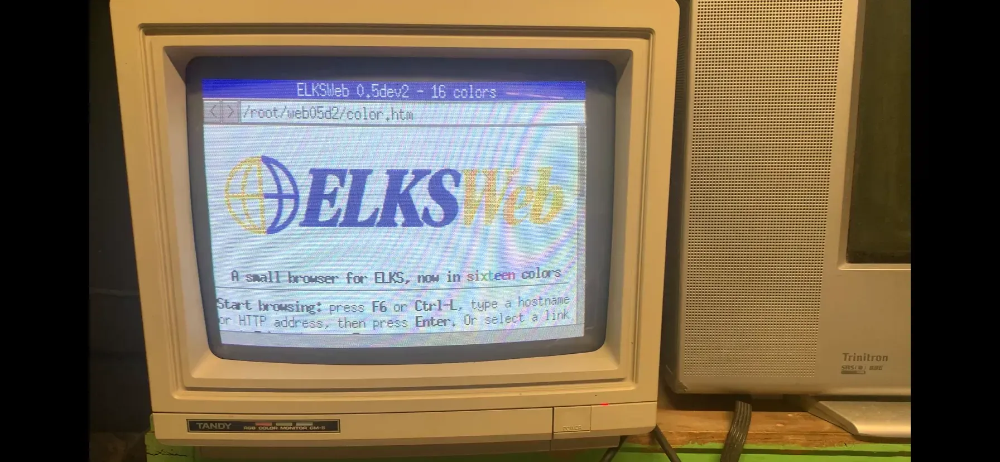
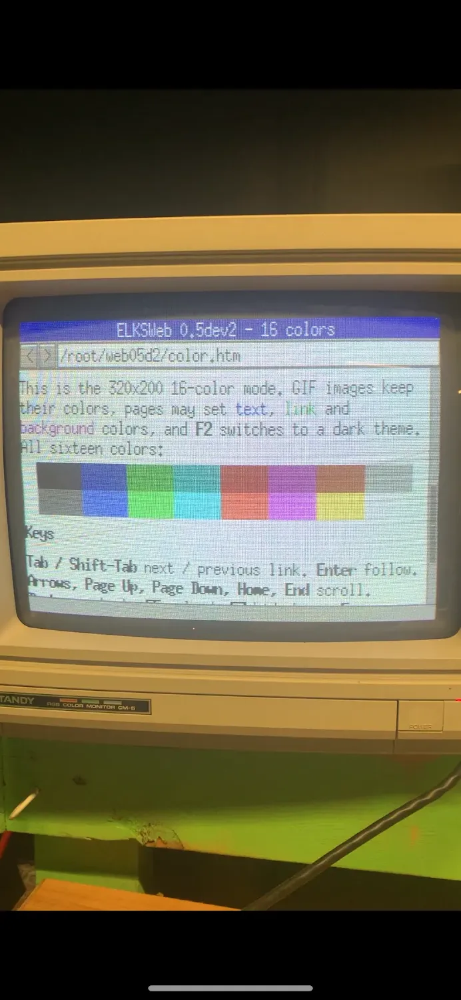

> ⚠️ I’m developing this project with AI assistance out of personal interest. It may not fully align with the ELKS maintainer team’s architectural or development guidelines. Please use it at your own discretion. ⚠️

<p align="center">

  
</p>

# ELKSWeb 0.5

An experimental graphical web browser for [ELKS Linux](https://github.com/ghaerr/elks), written in C with the native ELKS IA16 toolchain and targeting 8088-compatible machines.

Inspired by [the ELKS graphical-browser discussion (#2185)](https://github.com/ghaerr/elks/discussions/2185) and [MicroWeb](https://github.com/jhhoward/MicroWeb). ELKSWeb is an original implementation.

**What’s new in 0.5:** [Tandy/PCjr 16-colour support, colour GIFs and HTML colours](#colour-support-in-05), contributed by [@astrobleem](https://github.com/astrobleem), plus faster monochrome startup, text and GIF rendering. The HP 200LX and PPC console, keyboard and serial-mouse fixes are retained. [Download 0.5](https://github.com/l00nix/ELKSWeb/releases/tag/v0.5), read the [release notes](docs/RELEASE-0.5.md), or install from the [EPT mirror](http://ept.8088retro.com/) with `ept install elksweb` (general catalogue).

**Nightly 0.6.4dev:** Includes [astrobleem's download follow-up fixes (#7)](https://github.com/l00nix/ELKSWeb/issues/7#issuecomment-7156977194): filename editing repaints only the download controls, and successful downloads flush ELKS filesystem buffers before “File saved”. The form-field fix, HP/PPC fixes and combined package are retained. With `REPO=http://ept.8088retro.com` in `/etc/ept.cfg`, run `ept install -n elksweb`. Issue #7 remains open for candidate verification; the separate FrogFind page-cache report is tracked in [#8](https://github.com/l00nix/ELKSWeb/issues/8). General 0.5 is unchanged.

General IBM PC compatibility remains the goal.

## Shared welcome page in 0.6.2dev

The [0.6.2dev shared-page update](https://github.com/l00nix/ELKSWeb/tree/dev/0.6-nanox) combines `elksweb` and `webnx` in one EPT package. Both open `/lib/web/welcome.htm`, showing both logos, common controls and the direct-console/Nano-X launch options, following [ghaerr's suggestion](https://github.com/l00nix/ELKSWeb/pull/5#issuecomment-7112604032). Thanks to [astrobleem](https://github.com/astrobleem) for the colour support, Nano-X contribution and WebNX artwork. Stable 0.5 remains the general release.

**Physical Amstrad PPC 512 with PicoMEM 2:** the shared welcome page and both GIF logos, captured from the CGA framebuffer with inverted colours. The 640×200 pixels are enlarged for readability. This checks welcome-page rendering in the current configuration, not stock 512 KB or Nano-X operation.



**ELKS virtual machine:** the same welcome page in 640×480 VGA colour on a QEMU 486 with 8 MB RAM. This is the direct `elksweb` renderer.



**Shared colour demo:** both logos, coloured text and the 16-colour palette in the same VGA virtual machine.



Available through the [main 8088retro EPT nightly catalogue](http://ept.8088retro.com/). Set `REPO=http://ept.8088retro.com` in `/etc/ept.cfg` and use `ept install -n elksweb`; `/local` is no longer required. Fresh installs need no package removals; users of the old split packages should follow the [migration guide](https://github.com/l00nix/ELKSWeb/blob/dev/0.6-nanox/docs/NANOX-EXPERIMENT.md#install-and-migrate) first. [Capture details](docs/screenshots/0.6.2dev/captures.json). Physical PC-98 and intermittent Nano-X logo reports remain open.

## Live browsing on retro hardware

### Amstrad PPC 512

The FrogFind mirror and its frog GIF displayed on the Amstrad PPC 512's original LCD during ELKSWeb testing with PicoMEM 2. Photograph by l00nix.



HTTPedia displayed on the PPC 512 during 0.3-dev1 hardware testing. Photograph by l00nix.



### HP 200LX

ELKSWeb 0.2 on a physical HP 200LX, showing the welcome page and the FrogFind mirror with its GIF. Photographs by l00nix.





## Design

The C++, networking, graphics-dependency and memory concerns raised in [the ELKS graphical-browser discussion (#2185)](https://github.com/ghaerr/elks/discussions/2185) guide the implementation:

- **C and the native ELKS toolchain:** IA16 GCC and ELKS libc; no C++ runtime or OpenWatcom requirement.
- **ELKS networking:** native sockets and the ELKS `ktcp` service; no DOS packet driver or mTCP dependency. Direct access is HTTP only.
- **Direct graphics:** the browser draws directly to CGA, EGA, VGA or Tandy/PCjr video memory and uses ELKS console interfaces. Microwindows/Nano-X is not required.
- **Bounded memory:** segmented storage, explicit document limits and a small disk-backed source cache. These choices reduce conventional-memory pressure but currently incur substantial CPU and disk costs.

## Tested configuration and requirements

- An ELKS system with graphics-capable console interfaces and a working native network stack.
- 8088-compatible processor target. Earlier candidates were exercised in 86Box with an Intel 8088 at 4.77 MHz and 640 KB RAM. The owner confirms the exact 0.1 executable runs on the standard HP 200LX and DS HP 200LX, with smoother scrolling reported on the standard HP. Installation identities were verified separately from those owner graphics reports. Exact-0.1 86Box welcome, scrolling and a normal-shell exit passed; an earlier cold-boot exit anomaly remains unresolved. See the release notes.
- CGA 640×200, color EGA with at least 128 KB video RAM at 640×350, or VGA at 640×480. These three modes are monochrome. Mode selection and console restoration are exercised in QEMU and Windows 86Box; 0.1-specific results are recorded in the release notes. [CGA capture](docs/screenshots/frogfind-build004-cga-86box.png) · [EGA capture](docs/screenshots/frogfind-build004-ega-86box.png) · [VGA capture](docs/screenshots/frogfind-build004-vga-86box.png).
- Tandy 1000 or expanded PCjr built-in video at 320×200 in 16 colours, on an ELKS kernel that reserves the video memory at boot: the Tandy branch with `tandyvideo=1` in `/bootopts`, or the matched PCjr kernel and bootloader. ELKSWeb asks the kernel (`MEM_GETTANDY`/`MEM_GETPCJR` on `/dev/kmem`) and offers the mode only when the reservation is confirmed. The kernel must also have medium-model executables enabled (`CONFIG_EXEC_MMODEL`, on in the stock configurations).
- A writable `/tmp` for page caching.
- Keyboard navigation and serial-mouse input; 0.3-dev1 mouse movement and clicking passed user checks on the PPC 512 and HP 200LX DS. PS/2 coverage remains limited.

640 KB is the tested configuration, not a proven minimum. General ELKS compatibility is the priority.

### HP 200LX keyboard compatibility

On the [tested HP-specific ELKS setup](https://github.com/l00nix/elks-on-hp200lx), set this flag in the same shell before launching the browser:

```sh
export ELKSWEB_COOKED_KEYS=1
elksweb
```

`ELKSWEB_COOKED_KEYS=1` keeps ELKS-translated keyboard input (characters and escape sequences) instead of enabling the browser's default raw scan-code input. It is a compatibility setting for that HP setup, not a general requirement for IBM PCs or the PPC 512. Leave it unset for normal operation; use `unset ELKSWEB_COOKED_KEYS` to restore the default for subsequent launches.

Serial-mouse setup uses the same settings as the PPC 512, with the HP's cooked-key setting retained. The standard HP Connectivity Pack cable also needs a null-modem adapter for a mouse. See [HP 200LX mouse setup](docs/INSTALL.md#hp-200lx-serial-mouse) for wiring, port ownership and the complete launch command.

## Current features

HTTP and local HTML/text files, relative links, redirects, anchors, scrolling, forms, tables, lists, GIF images (monochrome, or 16 colours on the Tandy/PCjr display) and binary downloads. On the colour display, `<body bgcolor text link>` and `<font color>` are honoured with the nearest of the 16 fixed colours. PNG/JPEG dimensions are recognized for layout, but their pixels are not decoded. JPEG decoding is outside the current scope and is likely to remain outside future releases, similar to MicroWeb. Features have differing levels of test coverage; see [tests](tests/README.md).

## Colour support in 0.5

Thanks to **[@astrobleem (Chad Doebelin)](https://github.com/astrobleem)** for contributing native **Tandy/PCjr 320×200, 16-colour support**, colour GIF decoding, HTML text/background/link colours, light and dark themes, narrower layout and keyboard handling. He also contributed `color.htm`, the colour logo and the colour chart. His original commits are preserved in the project history; see [issue #2](https://github.com/l00nix/ELKSWeb/issues/2).

The photos below show his **0.5dev2** test of the colour welcome page and palette on a Tandy CM-5 monitor. Photographs by astrobleem, reproduced with [his permission](https://github.com/l00nix/ELKSWeb/issues/2#issuecomment-6982680891).





Colour mode needs the matching [Tandy kernel](https://github.com/astrobleem/elks/blob/tandy-video-v0.9.2/Documentation/tandy-video.txt) with `tandyvideo=1`, or the matched [PCjr kernel and bootloader](https://github.com/astrobleem/elks/blob/pcjr-video-v0.9.2/Documentation/pcjr-video.txt). The browser package does not install these system components. CGA, EGA and VGA output remains monochrome, including the PPC and HP 200LX configurations.

0.5 also retains the dev2 speed improvements: controlled PPC measurements reduced first-frame startup from **6.21 to 4.97 seconds**, and earlier GIF/text changes reduced complete welcome loading from **60.44 to 46.59 seconds**. These use instrumented candidates and fixed content, rather than final-release live Internet timings; see [methods and results](docs/PERFORMANCE-0.5.md).

## Limitations

- HTTP only; no native TLS, CSS or JavaScript. `HTTP_PROXY` is supported, but HTTPS conversion requires an external service and is not provided here.
- Graphics adapter detection is conservative: unsupported or unrecognized modes are rejected. EGA image aspect correction is approximate, and displayed images retain a 200-row limit in every mode.
- Large or complex pages can exceed fixed layout limits. HTML source is capped at 120 KB; layout at 24 KB of text, 1,024 runs and 256 links.
- Some accented characters are transliterated rather than rendered faithfully.
- Form fields retain at most 79 UTF-8 bytes; textarea editing is single-line. HTML `maxlength` and `size` semantics are not fully implemented. Form support does not imply modern HTML standards compliance.
- No claim of complete MicroWeb parity or physical 8088 certification. Further beta testing and feature enhancements are ongoing.

## Future enhancements

0.5 preserves the monochrome modes while adding experimental Tandy/PCjr colour. Follow-up work includes:

- **EGA/VGA colour GIF rendering**, while retaining monochrome CGA and HP 200LX output. This requires palette-aware image storage, video-plane drawing, scrolling and cursor handling, plus work to fit the 64 KB code-segment limit. The blue logo artwork is prepared for this future work; it is not the installed 0.1 logo.
- **Faster page loading and rendering**, with measured reductions in CPU, disk and memory use.
- **Broader compatibility testing**, including additional ELKS systems, physical 8088 machines and display adapters, and investigation of the remaining 86Box cold-boot exit anomaly.
- **HTML and input improvements**, including form controls, accented text and clearer handling of document limits.

These are directions, not promised features or dates. JPEG decoding remains outside the planned scope; ELKSWeb displays GIF pixels and uses JPEG/PNG dimensions for placeholders.

## Keyboard shortcuts

| Key | Action |
| --- | --- |
| F6 / Ctrl-L | Edit address |
| Tab / Shift-Tab | Select link or control |
| Enter | Activate selection |
| Arrows / Page Up / Page Down | Scroll |
| Home / End | Start / end of document |
| Backspace | Back |
| F5 | Reload |
| F2 | Invert monochrome output; dark theme on the colour display |
| F3 | Show/hide browser bars |
| Escape | Exit; cancel a network load when input is polled |

These navigation shortcuts apply to normal page browsing. In an address or text field, Left/Right, Home/End and Backspace edit the field; select/radio controls use arrows to change choices. Escape first dismisses address editing, an open select list or a download prompt.

## Command-line options

```text
elksweb [-video cga|ega|vga|tandy|pcjr] [-invert] [-noimages] [http://URL or local-file]
```

Without `-video`, ELKSWeb displays a text-console selector before entering graphics. Choose 1, 2 or 3 and press Enter; Enter alone selects CGA, and Q followed by Enter quits. Only detected modes are listed. `-video cga`, `-video ega` or `-video vga` bypasses the selector; unsupported modes fail without changing graphics or console settings.

When the kernel confirms a Tandy or PCjr video reservation the selector also lists `4`, the 320×200 16-colour mode, and Enter alone selects it. `-video tandy` and `-video pcjr` are the same mode. On the colour display the default start page is `/lib/elksweb/color.htm` when installed. Colour images are stored at four bits per pixel, reduced to fit the 304-pixel content width while decoding. Decoded pixel buffers are capped at 80 KB per page; transparency masks, compressed input and decoder working memory are additional. Images are retried at lower resolutions when memory is short, but can still become placeholders if all attempts fail.

Keyboard notes for these machines: the PCjr kernel reads keys through the BIOS, so ELKSWeb uses translated keys there automatically. On a Tandy the original 90-key keyboard's arrow and Home scan codes are accepted as well as the XT ones; set `ELKSWEB_KEYBOARD=xt` to disable that, or `ELKSWEB_KEYBOARD=tandy` to force it.

This colour mode is experimental. The supplied implementation was exercised in 86Box Tandy 1000 HX and DOSBox-X PCjr emulation. Astrobleem subsequently reported a working 0.5dev2 test and supplied the photos above; this is not a complete qualification of every Tandy/PCjr configuration. The additional Tandy 90-key mappings have not been verified against hardware or a reference. PMR mouse support is not implemented; reported mouse checks used an emulated Microsoft serial mouse. PCjr memory pressure can reduce image quality or leave placeholders. Emulator results do not certify the Tandy EX or a particular physical network adapter configuration.

`--version` prints the version without entering graphics. `-noimages` disables image loading. It does not establish a performance target. EMS and XMS options are not implemented.

## How to install a release

Download the [0.5 runtime package](https://github.com/l00nix/ELKSWeb/releases/tag/v0.5) on a modern computer, verify its checksum, and transfer it to an existing ELKS installation. Install `bin/elksweb` as `/bin/elksweb` and the files in `lib/elksweb/` under `/lib/elksweb/`. The executable is always named `elksweb`. Keep the included notices and corresponding-source archive available.

```sh
chmod 755 /bin/elksweb
elksweb --version
elksweb
```

The version reports **0.5**. Choose a detected display mode to open the local welcome page. Configure native ELKS networking and run `net start` before using HTTP. Enter a hostname such as `68knews.8088retro.com` in the address field or an explicit URL.

See [INSTALL.md](docs/INSTALL.md) for exact file paths, checksums, mouse settings and upgrades. The runtime is a standalone application package, not an ELKS disk image. [BUILDING.md](docs/BUILDING.md) describes both source-build workflows.

## Low-memory systems

On memory-constrained systems, ELKSWeb may fail to start or display GIF images. Available memory depends on the ELKS configuration and running services; a GIF can fail even when its compressed file is small.

From the machine's local graphics console, prefix your normal launch command with `exec` to replace the waiting shell and free its memory. For a standard installation:

```sh
exec elksweb
```

Keep any display options and mouse or keyboard environment settings you normally use. If you have a custom launcher, use `exec /root/startweb` instead. After exiting from a normal login session, log in again.

This workaround allowed ELKSWeb 0.3 to render the welcome page and its GIF, then return cleanly to login, in an offline reduced-memory Amstrad PPC 512 hardware test. Subsequent 512 KB tests with `ktcp` alone could not start either 0.3 or 0.35dev. Use 640 KB or more as the practical starting point for testing; free memory still depends on the kernel and running services. `-noimages` can also disable image loading, but does not guarantee that the browser will fit. See [issue #1](https://github.com/l00nix/ELKSWeb/issues/1) for measurements and planned improvements.

## Test sites and related projects

- [68k news mirror](http://68knews.8088retro.com/) — linked from the welcome page; historical screenshots also used the original 68k.news site; [ActionRetro/68k-news source](https://github.com/ActionRetro/68k-news).
- [FrogFind](http://frogfind.com/) — current live QA uses the supplied [HTTP mirror](http://frogfind.8088retro.com/). The original hostname failed in the historical Windows run. Repeatable file and HTTP examples are under [tests/fixtures/frogfind](tests/fixtures/frogfind/README.txt); these are labelled fixed fixtures, not live search. [Source](https://github.com/ActionRetro/FrogFind).
- [HTTPedia](http://httpedia.com/) — additional testing target; external availability may vary.
- [MicroWeb](https://github.com/jhhoward/MicroWeb) — inspiration and independent comparison reference.
- [ELKS](https://github.com/ghaerr/elks) — operating system, toolchain and networking.

These projects are credited for their respective work; no endorsement or affiliation is implied.

## Contributing

See [CONTRIBUTING.md](CONTRIBUTING.md) and the [beta testing checklist](docs/BETA-TESTING.md). See the [0.5 release notes](docs/RELEASE-0.5.md) and [development integration record](docs/DEVELOPMENT-0.5.md). Historical checks remain in STATUS; broader compatibility and performance feedback are welcome. Testers and feedback are welcome.

## License and attribution

Original browser code is GPL-2.0-or-later; see [COPYING](COPYING). Independently sourced font data retains its [X.Org public-domain notice](font/COPYING) and [provenance](font/provenance.json). No MicroWeb source, font, image assets or executable is embedded in ELKSWeb. The separately attributed FrogFind test fixture retains its GPL-3.0 license and provenance under [tests/fixtures/frogfind](tests/fixtures/frogfind/README.txt). Website content visible in screenshots belongs to its respective providers. Astrobleem’s photographs are reproduced with permission; see [photo provenance](docs/screenshots/colour/README.md).
