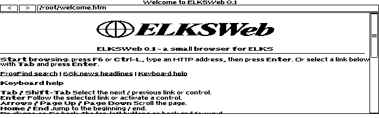

# ELKSWeb 0.1

An experimental graphical web browser for [ELKS Linux](https://github.com/ghaerr/elks), written in C with the native ELKS IA16 toolchain and targeting 8088-compatible machines.

Inspired by [the ELKS graphical-browser discussion (#2185)](https://github.com/ghaerr/elks/discussions/2185) and [MicroWeb](https://github.com/jhhoward/MicroWeb). ELKSWeb is an original implementation; MicroWeb is the visual and behavioral comparison reference.

**Version 0.1 — experimental beta, staged privately; final QA remains open.** This release adds display selection, a stable application frame and incremental vertical scrolling: existing pixels move and only the exposed strip is rendered again. It remains an original C implementation built with the native ELKS toolchain. See [0.1 release notes](docs/RELEASE-0.1.md) for exact artifacts, validation and limits. The owner confirms this exact version runs on both the standard HP 200LX and the owner-identified DS HP 200LX, and reports smoother scrolling on the standard HP. This is owner feedback, not an independently captured hardware benchmark. Speed and responsiveness remain outside the first-beta release decision.



Actual default help page and original GIF logo, QEMU CGA, 16 October 2026. [Display selector](docs/screenshots/0.1/selector-qemu.png) · [EGA welcome](docs/screenshots/0.1/welcome-ega-qemu.png) · [VGA welcome](docs/screenshots/0.1/welcome-vga-qemu.png). No-URL startup, the keyboard-help anchor, scrolling, inversion and console restoration passed in all three modes on the refreshed help/logo image.

Additional 0.1 live-site captures: [68k.news homepage](docs/screenshots/68k-news-0.1-qemu.png) · [Scrolled news viewport](docs/screenshots/68k-news-0.1-qemu-scrolled.png) · [FrogFind mirror](docs/screenshots/frogfind-0.1-qemu.png). These captures exercise the validated 0.1 QEMU image, before the later help-page/logo packaging refresh; QEMU uses a 486 CPU for ELKS integration testing. The earlier [build005 Windows 86Box capture](docs/screenshots/68k-news-build005-86box.png) used an Intel 8088 at 4.77 MHz with 640 KB RAM. See the [8088 validation scope](docs/8088-VALIDATION.md), including the guest CPU-label discrepancy.

## Design

The discussion's C++, networking, graphics-dependency and memory concerns guide the implementation:

- **C and the native ELKS toolchain:** IA16 GCC and ELKS libc; no C++ runtime or OpenWatcom requirement.
- **ELKS networking:** native sockets and the ELKS `ktcp` service; no DOS packet driver or mTCP dependency. Direct access is HTTP only.
- **Direct graphics:** the browser draws directly to CGA, EGA or VGA video memory and uses ELKS console interfaces. Microwindows/Nano-X is not required.
- **Bounded memory:** segmented storage, explicit document limits and a small disk-backed source cache. These choices reduce conventional-memory pressure but currently incur substantial CPU and disk costs.

## Tested configuration and requirements

- An ELKS system with graphics-capable console interfaces and a working native network stack.
- 8088-compatible processor target. Earlier candidates were exercised in 86Box with an Intel 8088 at 4.77 MHz and 640 KB RAM. The owner confirms the exact 0.1 executable runs on the standard HP 200LX and DS HP 200LX, with smoother scrolling reported on the standard HP. Installation identities were verified separately from those owner graphics reports. Exact-0.1 86Box welcome, scrolling and a normal-shell exit passed; an earlier cold-boot exit anomaly remains unresolved. See the release notes.
- CGA 640×200, color EGA with at least 128 KB video RAM at 640×350, or VGA at 640×480. All browser modes are monochrome. Mode selection and console restoration are exercised in QEMU and Windows 86Box; 0.1-specific results are recorded in the release notes. [CGA capture](docs/screenshots/frogfind-build004-cga-86box.png) · [EGA capture](docs/screenshots/frogfind-build004-ega-86box.png) · [VGA capture](docs/screenshots/frogfind-build004-vga-86box.png).
- A writable `/tmp` for page caching.
- Keyboard navigation; PS/2 mouse support exists but was not tested in the 8088 run.

640 KB is the tested configuration, not a proven minimum. General ELKS compatibility is the priority. On the tested HP 200LX 3.8 beta 1 firmware, set `ELKSWEB_COOKED_KEYS=1` to use its translated keyboard input.

## Current features

HTTP and local HTML/text files, relative links, redirects, anchors, scrolling, forms, tables, lists, monochrome GIF images and binary downloads. PNG/JPEG dimensions are recognized for layout, but their pixels are not decoded. JPEG decoding is explicitly outside the 0.1 scope. Features have differing levels of test coverage; see [tests](tests/README.md).

## Limitations

- 8088 page loads remain slow: the build005 live news viewport was observed roughly eight minutes after launch. Incremental scrolling reduces repeated drawing, but physical timing benchmarks remain pending.
- History and receive cancellation pass 12 native QEMU checks; the final-image regression and scoped resource-failure checks also pass. Owner reports cover startup/use on two physical HP systems; exhaustive feature combinations and independently captured physical-hardware QA remain untested.
- HTTP only; no native TLS, CSS or JavaScript. `HTTP_PROXY` is supported, but HTTPS conversion requires an external service and is not provided here.
- Adapter detection is conservative: unsupported or unrecognized modes are rejected. EGA image aspect correction is approximate, and displayed images retain a 200-row limit in every mode.
- Large or complex pages can exceed fixed layout limits. HTML source is capped at 120 KB; layout at 24 KB of text, 1,024 runs and 256 links.
- Some accented characters are transliterated rather than rendered faithfully.
- Form fields retain at most 79 UTF-8 bytes; textarea editing is single-line. HTML `maxlength` and `size` semantics are not fully implemented. Form support does not imply modern HTML standards compliance.
- No claim of complete MicroWeb parity or physical 8088 certification. Publication remains subject to owner approval.

## Future enhancements

Version 0.1 keeps the tested monochrome renderer. Follow-up work under consideration includes:

- **EGA/VGA colour GIF rendering**, while retaining monochrome CGA and HP 200LX output. This requires palette-aware image storage, video-plane drawing, scrolling and cursor handling, plus work to fit the 64 KB code-segment limit. The blue logo artwork is prepared for this future work; it is not the installed 0.1 logo.
- **Faster page loading and rendering**, with measured reductions in CPU, disk and memory use.
- **Broader compatibility testing**, including additional ELKS systems, physical 8088 machines and display adapters, and investigation of the remaining 86Box cold-boot exit anomaly.
- **HTML and input improvements**, including form controls, accented text and clearer handling of document limits.

These are directions, not promised features or dates. JPEG decoding remains outside the planned scope; 0.1 displays GIF pixels and uses JPEG/PNG dimensions for placeholders.

## Keyboard shortcuts

| Key | Action |
| --- | --- |
| F6 / Ctrl-L | Edit address |
| Tab / Shift-Tab | Select link or control |
| Enter | Activate selection |
| Arrows / Page Up / Page Down | Scroll |
| Home / End | Start / end of document |
| Backspace | Back |
| F5 | Reload |
| F2 | Invert monochrome output |
| F3 | Show/hide browser bars |
| Escape | Exit; cancel a network load when input is polled |

These navigation shortcuts apply to normal page browsing. In an address or text field, Left/Right, Home/End and Backspace edit the field; select/radio controls use arrows to change choices. Escape first dismisses address editing, an open select list or a download prompt.

## Command-line options

```text
elksweb [-video cga|ega|vga] [-invert] [-noimages] [http://URL or local-file]
```

Without `-video`, ELKSWeb displays a text-console selector before entering graphics. Choose 1, 2 or 3 and press Enter; Enter alone selects CGA, and Q followed by Enter quits. Only detected modes are listed. `-video cga`, `-video ega` or `-video vga` bypasses the selector; unsupported modes fail without changing graphics or console settings.

`--version` prints the version without entering graphics. `-noimages` disables image loading. It does not establish a performance target. EMS and XMS options are not implemented.

## Getting started and building

The normal runtime package contains the native executable, its default HTML help page, an original GIF logo and required notices. Install the executable as `/bin/elksweb`, the help page as `/root/welcome.htm`, and the logo as `/root/elksweb.gif`; launching `elksweb` without a URL opens the help page.

Corresponding source is supplied separately. The QEMU test image and offline fixtures are optional testing downloads, not runtime requirements. The project-specific `webfrog` and `webnews` launchers are not part of the normal package. Verify the checksums supplied with the chosen artifact. The repository and release draft remain private. Runtime, corresponding-source and optional test-image archives are provided separately with checksum sidecars. The first 86Box welcome-page run had an unresolved cold-boot exit anomaly; a normal-shell welcome/scroll/exit repeat passed. See [the current QA hold](docs/8088-VALIDATION.md#exact-01-follow-up--incomplete).

See [BUILDING.md](docs/BUILDING.md) for native compilation, optional image packaging and QEMU testing. Emulator boot success must be evaluated separately from slow 8088 behavior.

## Test sites and related projects

- [68k.news](http://68k.news/) — used in the actual live screenshots; [ActionRetro/68k-news source](https://github.com/ActionRetro/68k-news).
- [FrogFind](http://frogfind.com/) — current live QA uses the supplied [HTTP mirror](http://frogfind.8088retro.com/). The original hostname failed in the historical Windows run. Repeatable file and HTTP examples are under [tests/fixtures/frogfind](tests/fixtures/frogfind/README.txt); these are labelled fixed fixtures, not live search. [Source](https://github.com/ActionRetro/FrogFind).
- [MicroWeb](https://github.com/jhhoward/MicroWeb) — inspiration and independent comparison reference.
- [ELKS](https://github.com/ghaerr/elks) — operating system, toolchain and networking.

These projects are credited for their respective work; no endorsement or affiliation is implied.

## Contributing

See [CONTRIBUTING.md](CONTRIBUTING.md) and the [beta testing checklist](docs/BETA-TESTING.md). The scoped 0.1 visual, functional, resource-recovery and build checks, plus historical clean-build evidence, are recorded in STATUS; broader compatibility testing remains valuable. Speed and responsiveness improvements are follow-up work and do not gate the first public beta. The repository remains private during this work.

## License and attribution

Original browser code is GPL-2.0-or-later; see [COPYING](COPYING). Independently sourced font data retains its [X.Org/Adobe/DEC notices](font/COPYING) and [provenance](font/provenance.json). No MicroWeb source, font, image assets or executable is embedded in ELKSWeb. The separately attributed FrogFind test fixture retains its GPL-3.0 license and provenance under [tests/fixtures/frogfind](tests/fixtures/frogfind/README.txt). Website content visible in screenshots belongs to its respective providers.
