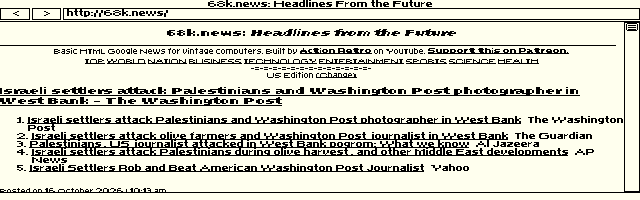

# ELKSWeb

An experimental graphical web browser for [ELKS Linux](https://github.com/ghaerr/elks), written in C with the native ELKS IA16 toolchain and targeting 8088-compatible machines.

Inspired by [the ELKS graphical-browser discussion (#2185)](https://github.com/ghaerr/elks/discussions/2185) and [MicroWeb](https://github.com/jhhoward/MicroWeb). ELKSWeb is an original implementation; MicroWeb is the visual and behavioral comparison reference.

**Private beta preparation — not ready for public beta.** The current candidate adds display selection and fixes local-file history. Native QEMU checks pass; an 8088 rerun still takes minutes, and clean-build validation remains pending. See [known issues and test evidence](docs/STATUS.md).



Build003: actual 640×200 CGA framebuffer from Windows 86Box, 16 October 2026. Intel 8088 at 4.77 MHz, 640 KB RAM. The first live 68k.news viewport was first observed roughly 5–9 minutes after launch; Page Down responded and completed by the next observation. This remains too slow for beta. Build004 subsequently fixes reduced GIF rendering; its [latest 68k.news capture](docs/screenshots/68k-news-build004-qemu.png) and [FrogFind mirror capture](docs/screenshots/frogfind-build004-qemu.png) are from QEMU, not 8088 timing tests. Earlier [scrolled view](docs/screenshots/68k-page-down.png) and [footer](docs/screenshots/68k-footer.png) remain historical evidence.

## Design

The discussion's C++, networking, graphics-dependency and memory concerns guide the implementation:

- **C and the native ELKS toolchain:** IA16 GCC and ELKS libc; no C++ runtime or OpenWatcom requirement.
- **ELKS networking:** native sockets and the ELKS `ktcp` service; no DOS packet driver or mTCP dependency. Direct access is HTTP only.
- **Direct graphics:** the browser draws directly to CGA, EGA or VGA video memory and uses ELKS console interfaces. Microwindows/Nano-X is not required.
- **Bounded memory:** segmented storage, explicit document limits and a small disk-backed source cache. These choices reduce conventional-memory pressure but currently incur substantial CPU and disk costs.

## Tested configuration and requirements

- An ELKS system with graphics-capable console interfaces and a working native network stack.
- 8088-compatible processor target; exercised in 86Box with an Intel 8088 at 4.77 MHz and 640 KB RAM. Physical hardware remains unvalidated.
- CGA 640×200, color EGA with at least 128 KB video RAM at 640×350, or VGA at 640×480. All browser modes are monochrome. Mode selection and console restoration are exercised in QEMU and Windows 86Box; physical adapters remain unvalidated. [CGA capture](docs/screenshots/frogfind-build004-cga-86box.png) · [EGA capture](docs/screenshots/frogfind-build004-ega-86box.png) · [VGA capture](docs/screenshots/frogfind-build004-vga-86box.png).
- A writable `/tmp` for page caching.
- Keyboard navigation; PS/2 mouse support exists but was not tested in the 8088 run.

640 KB is the tested configuration, not a proven minimum. General ELKS compatibility is the priority; HP 200LX/Hornet-specific validation is future work.

## Current features

HTTP and local HTML/text files, relative links, redirects, anchors, scrolling, forms, tables, lists, monochrome GIF images and binary downloads. PNG/JPEG dimensions are recognized for layout, but their pixels are not decoded. Features have differing levels of test coverage; see [tests](tests/README.md).

## Limitations

- 8088 page loads remain slow: build003 took roughly 5–9 minutes to the first live news viewport. Source-cache and parsing improvements are implemented; build004 timing and controlled same-content benchmarks remain pending.
- Local-file history is fixed and passed nine native QEMU checks; broader regression and resource-failure coverage remain release gates.
- HTTP only; no native TLS, CSS or JavaScript. `HTTP_PROXY` is supported, but HTTPS conversion requires an external service and is not provided here.
- Adapter detection is conservative: unsupported or unrecognized modes are rejected. EGA image aspect correction is approximate, and displayed images retain a 200-row limit in every mode.
- Large or complex pages can exceed fixed layout limits. HTML source is capped at 120 KB; layout at 24 KB of text, 1,024 runs and 256 links.
- Some accented characters are transliterated rather than rendered faithfully.
- No claim of complete MicroWeb parity, physical 8088 certification or public-beta readiness.

## Keyboard shortcuts

| Key | Action |
| --- | --- |
| F6 / Ctrl-L | Edit address |
| Tab / Shift-Tab | Select link or control |
| Enter | Activate selection |
| Arrows / Page Up / Page Down | Scroll |
| Home / End | Start / end of document |
| Backspace | Back |
| F5 | Reload |
| F2 | Invert monochrome output |
| F3 | Show/hide browser bars |
| Escape | Exit; cancel a network load when input is polled |

## Command-line options

```text
elksweb [-video cga|ega|vga] [-invert] [-noimages] [http://URL or local-file]
```

Without `-video`, ELKSWeb displays a text-console selector before entering graphics. Choose 1, 2 or 3 and press Enter; Enter alone selects CGA, and Q followed by Enter quits. Only detected modes are listed. `-video cga`, `-video ega` or `-video vga` bypasses the selector; unsupported modes fail without changing graphics or console settings.

`-noimages` disables image loading. It does not establish a performance target. EMS and XMS options are not implemented.

## Getting started and building

This initial repository contains source, tests and screenshots. No ready-to-use release image is published yet.

See [BUILDING.md](docs/BUILDING.md) for native compilation, optional image packaging and QEMU testing. Emulator boot success must be evaluated separately from slow 8088 behavior.

## Test sites and related projects

- [68k.news](http://68k.news/) — used in the actual live screenshots; [ActionRetro/68k-news source](https://github.com/ActionRetro/68k-news).
- [FrogFind](http://frogfind.com/) — current live QA uses the supplied [HTTP mirror](http://frogfind.8088retro.com/). The original hostname failed in the historical Windows run. Repeatable file and HTTP examples are under [tests/fixtures/frogfind](tests/fixtures/frogfind/README.txt); these are labelled fixed fixtures, not live search. [Source](https://github.com/ActionRetro/FrogFind).
- [MicroWeb](https://github.com/jhhoward/MicroWeb) — inspiration and independent comparison reference.
- [ELKS](https://github.com/ghaerr/elks) — operating system, toolchain and networking.

These projects are credited for their respective work; no endorsement or affiliation is implied.

## Contributing

See [CONTRIBUTING.md](CONTRIBUTING.md). Current priorities are measuring the revised 8088 path, completing current-candidate visual and functional review, improving progress/cancellation, and validating a reproducible build/install before broader testing. The repository remains private during this work.

## License and attribution

Original browser code is GPL-2.0-or-later; see [COPYING](COPYING). Independently sourced font data retains its [X.Org/Adobe/DEC notices](font/COPYING) and [provenance](font/provenance.json). No MicroWeb source, font, image assets or executable is embedded in ELKSWeb. The separately attributed FrogFind test fixture retains its GPL-3.0 license and provenance under [tests/fixtures/frogfind](tests/fixtures/frogfind/README.txt). Website content visible in screenshots belongs to its respective providers.
