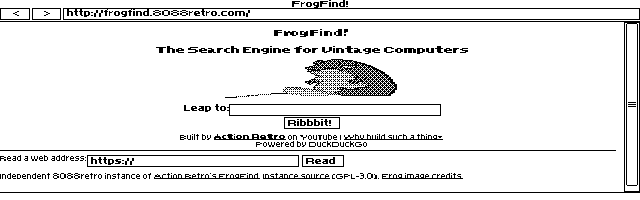

<p align="center">
  
</p>

# ELKSWeb 0.1

An experimental graphical web browser for [ELKS Linux](https://github.com/ghaerr/elks), written in C with the native ELKS IA16 toolchain and targeting 8088-compatible machines.

Inspired by [the ELKS graphical-browser discussion (#2185)](https://github.com/ghaerr/elks/discussions/2185) and [MicroWeb](https://github.com/jhhoward/MicroWeb). ELKSWeb is an original implementation.

**Version 0.1 — experimental beta.** This release features display selection and smooth scrolling. It remains an original C implementation built with the native ELKS toolchain. See [0.1 release notes](docs/RELEASE-0.1.md) for exact artifacts, validation and limits. This version has been confirmed to run on both the standard HP 200LX and a modified double-speed (DS) HP 200LX.

## Live Internet browsing on the HP 200LX

ELKSWeb 0.1 successfully loaded and rendered **68k.news** and the **FrogFind mirror** on a physical double-speed HP 200LX over an Accton EN2216 R02 PCMCIA Ethernet card, using the native ELKS `ktcp` stack. These are photographs of the actual palmtop.


DNS resolution and a LAN HTTP download with a matching checksum also passed. The roughly 92 KB 68k.news page eventually rendered after a long **Parsing...** stage; no controlled timing measurement was made. This run confirms homepage loading and rendering, including the FrogFind GIF. Link navigation and search submission on this hardware remain to be tested.

The run used an experimental HP-specific ELKS build with local Accton compatibility and interrupt-routing fixes. The permanent routing fix has been built and tested in software but still needs installation and a fresh hardware boot. These results do not mean the stock kernel or published browser package includes those NIC fixes. See the [hardware test report](docs/HP200LX-INTERNET-TEST.md) for scope and findings.

Testing on an **Amstrad PPC 512** is planned in the coming days; no PPC 512 result is claimed yet.

## Emulator screenshots


Actual default help page and original GIF logo, QEMU CGA. [Display selector](docs/screenshots/0.1/selector-qemu.png) · [EGA welcome](docs/screenshots/0.1/welcome-ega-qemu.png) · [VGA welcome](docs/screenshots/0.1/welcome-vga-qemu.png). No-URL startup, the keyboard-help anchor, scrolling, inversion and console restoration passed in all three modes on the refreshed help/logo image.

Additional 0.1 live-site captures: [68k.news homepage](docs/screenshots/68k-news-0.1-qemu.png) · [Scrolled news viewport](docs/screenshots/68k-news-0.1-qemu-scrolled.png) · [FrogFind mirror](docs/screenshots/frogfind-0.1-qemu.png). These captures exercise the validated 0.1 QEMU image, before the later help-page/logo packaging refresh; QEMU uses a 486 CPU for ELKS integration testing. The earlier [build005 Windows 86Box capture](docs/screenshots/68k-news-build005-86box.png) used an Intel 8088 at 4.77 MHz with 640 KB RAM. See the [8088 validation scope](docs/8088-VALIDATION.md), including the guest CPU-label discrepancy.

The [FrogFind mirror](http://frogfind.8088retro.com/) homepage with its frog GIF in ELKSWeb 0.1. Actual live-site capture from QEMU CGA.



## Design

The C++, networking, graphics-dependency and memory concerns raised in [the ELKS graphical-browser discussion (#2185)](https://github.com/ghaerr/elks/discussions/2185) guide the implementation:

- **C and the native ELKS toolchain:** IA16 GCC and ELKS libc; no C++ runtime or OpenWatcom requirement.
- **ELKS networking:** native sockets and the ELKS `ktcp` service; no DOS packet driver or mTCP dependency. Direct access is HTTP only.
- **Direct graphics:** the browser draws directly to CGA, EGA or VGA video memory and uses ELKS console interfaces. Microwindows/Nano-X is not required.
- **Bounded memory:** segmented storage, explicit document limits and a small disk-backed source cache. These choices reduce conventional-memory pressure but currently incur substantial CPU and disk costs.

## Tested configuration and requirements

- An ELKS system with graphics-capable console interfaces and a working native network stack.
- 8088-compatible processor target. Earlier candidates were exercised in 86Box with an Intel 8088 at 4.77 MHz and 640 KB RAM. The owner confirms the exact 0.1 executable runs on the standard HP 200LX and DS HP 200LX, with smoother scrolling reported on the standard HP. Installation identities were verified separately from those owner graphics reports. Exact-0.1 86Box welcome, scrolling and a normal-shell exit passed; an earlier cold-boot exit anomaly remains unresolved. See the release notes.
- CGA 640×200, color EGA with at least 128 KB video RAM at 640×350, or VGA at 640×480. All browser modes are monochrome. Mode selection and console restoration are exercised in QEMU and Windows 86Box; 0.1-specific results are recorded in the release notes. [CGA capture](docs/screenshots/frogfind-build004-cga-86box.png) · [EGA capture](docs/screenshots/frogfind-build004-ega-86box.png) · [VGA capture](docs/screenshots/frogfind-build004-vga-86box.png).
- A writable `/tmp` for page caching.
- Keyboard navigation; PS/2 mouse support exists but was not tested in the 8088 run.

640 KB is the tested configuration, not a proven minimum. General ELKS compatibility is the priority. On the tested HP 200LX setup ([ELKS Linux on the HP 200LX](https://github.com/l00nix/elks-on-hp200lx)), set `ELKSWEB_COOKED_KEYS=1` to use its translated keyboard input.

## Current features

HTTP and local HTML/text files, relative links, redirects, anchors, scrolling, forms, tables, lists, monochrome GIF images and binary downloads. PNG/JPEG dimensions are recognized for layout, but their pixels are not decoded. JPEG decoding is outside the 0.1 scope and is likely to remain outside future releases, similar to MicroWeb. Features have differing levels of test coverage; see [tests](tests/README.md).

## Limitations

- HTTP only; no native TLS, CSS or JavaScript. `HTTP_PROXY` is supported, but HTTPS conversion requires an external service and is not provided here.
- Graphics adapter detection is conservative: unsupported or unrecognized modes are rejected. EGA image aspect correction is approximate, and displayed images retain a 200-row limit in every mode.
- Large or complex pages can exceed fixed layout limits. HTML source is capped at 120 KB; layout at 24 KB of text, 1,024 runs and 256 links.
- Some accented characters are transliterated rather than rendered faithfully.
- Form fields retain at most 79 UTF-8 bytes; textarea editing is single-line. HTML `maxlength` and `size` semantics are not fully implemented. Form support does not imply modern HTML standards compliance.
- No claim of complete MicroWeb parity or physical 8088 certification. Further beta testing and feature enhancements are ongoing.

## Future enhancements

Version 0.1 keeps the tested monochrome renderer. Follow-up work under consideration includes:

- **EGA/VGA colour GIF rendering**, while retaining monochrome CGA and HP 200LX output. This requires palette-aware image storage, video-plane drawing, scrolling and cursor handling, plus work to fit the 64 KB code-segment limit. The blue logo artwork is prepared for this future work; it is not the installed 0.1 logo.
- **Faster page loading and rendering**, with measured reductions in CPU, disk and memory use.
- **Broader compatibility testing**, including additional ELKS systems, physical 8088 machines and display adapters, and investigation of the remaining 86Box cold-boot exit anomaly.
- **HTML and input improvements**, including form controls, accented text and clearer handling of document limits.

These are directions, not promised features or dates. JPEG decoding remains outside the planned scope; 0.1 displays GIF pixels and uses JPEG/PNG dimensions for placeholders.

## Keyboard shortcuts

| Key | Action |
| --- | --- |
| F6 / Ctrl-L | Edit address |
| Tab / Shift-Tab | Select link or control |
| Enter | Activate selection |
| Arrows / Page Up / Page Down | Scroll |
| Home / End | Start / end of document |
| Backspace | Back |
| F5 | Reload |
| F2 | Invert monochrome output |
| F3 | Show/hide browser bars |
| Escape | Exit; cancel a network load when input is polled |

These navigation shortcuts apply to normal page browsing. In an address or text field, Left/Right, Home/End and Backspace edit the field; select/radio controls use arrows to change choices. Escape first dismisses address editing, an open select list or a download prompt.

## Command-line options

```text
elksweb [-video cga|ega|vga] [-invert] [-noimages] [http://URL or local-file]
```

Without `-video`, ELKSWeb displays a text-console selector before entering graphics. Choose 1, 2 or 3 and press Enter; Enter alone selects CGA, and Q followed by Enter quits. Only detected modes are listed. `-video cga`, `-video ega` or `-video vga` bypasses the selector; unsupported modes fail without changing graphics or console settings.

`--version` prints the version without entering graphics. `-noimages` disables image loading. It does not establish a performance target. EMS and XMS options are not implemented.

## How to install a release

**No compiler is needed.** ELKSWeb runs on an existing compatible ELKS installation with a graphics console and writable `/tmp`; it does not install ELKS itself. Download the files using a modern computer: GitHub uses HTTPS, which ELKSWeb cannot access directly. The [0.1 experimental prerelease and downloads](https://github.com/l00nix/ELKSWeb/releases/tag/v0.1) are publicly available.

1. Open [Releases](https://github.com/l00nix/ELKSWeb/releases) and expand the 0.1 **Assets** list.
2. For a first installation, download **`ELKSWeb-0.1-runtime.tar.gz`** and its `.sha256` file. It includes the compiled browser, welcome HTML, GIF logo and notices. Download **`elksweb`** and its `.sha256` instead if you only need the executable to update an existing installation.
3. Verify the checksum on the modern computer, then extract the runtime archive there. Transfer files to the ELKS disk using your existing binary-safe serial transfer, network transfer or mounted-disk workflow. The [installation guide](docs/INSTALL.md) gives checksum commands and the exact source/destination file list.
4. Transfer the executable to `/root/elksweb`. For a first installation, also place the welcome page at `/root/welcome.htm`, logo at `/root/elksweb.gif` and logo provenance at `/root/logo-src.txt`; retain the supplied notices. Exit any running browser, then run these commands **on the ELKS graphics console as root**:

```sh
cp /root/elksweb /bin/elksweb
chmod 755 /bin/elksweb
elksweb --version
elksweb
```

The version should report **0.1**. Choose a detected display mode; the local welcome page should open without a network connection. Escape exits. For online browsing, configure ELKS networking first, then try `elksweb http://68k.news/`.

On the tested HP 200LX ELKS Linux setup, run `export ELKSWEB_COOKED_KEYS=1` before launching the browser. See [full installation, upgrade and troubleshooting instructions](docs/INSTALL.md).

For building from source or emulator testing, see [BUILDING.md](docs/BUILDING.md).

## Test sites and related projects

- [68k.news](http://68k.news/) — used in the actual live screenshots; [ActionRetro/68k-news source](https://github.com/ActionRetro/68k-news).
- [FrogFind](http://frogfind.com/) — current live QA uses the supplied [HTTP mirror](http://frogfind.8088retro.com/). The original hostname failed in the historical Windows run. Repeatable file and HTTP examples are under [tests/fixtures/frogfind](tests/fixtures/frogfind/README.txt); these are labelled fixed fixtures, not live search. [Source](https://github.com/ActionRetro/FrogFind).
- [MicroWeb](https://github.com/jhhoward/MicroWeb) — inspiration and independent comparison reference.
- [ELKS](https://github.com/ghaerr/elks) — operating system, toolchain and networking.

These projects are credited for their respective work; no endorsement or affiliation is implied.

## Contributing

See [CONTRIBUTING.md](CONTRIBUTING.md) and the [beta testing checklist](docs/BETA-TESTING.md). The scoped 0.1 visual, functional, resource-recovery and build checks, plus historical clean-build evidence, are recorded in STATUS; broader compatibility testing remains valuable. Speed and responsiveness improvements are follow-up work and do not gate the first public beta. Testers and feedback are welcome.

## License and attribution

Original browser code is GPL-2.0-or-later; see [COPYING](COPYING). Independently sourced font data retains its [X.Org/Adobe/DEC notices](font/COPYING) and [provenance](font/provenance.json). No MicroWeb source, font, image assets or executable is embedded in ELKSWeb. The separately attributed FrogFind test fixture retains its GPL-3.0 license and provenance under [tests/fixtures/frogfind](tests/fixtures/frogfind/README.txt). Website content visible in screenshots belongs to its respective providers.
